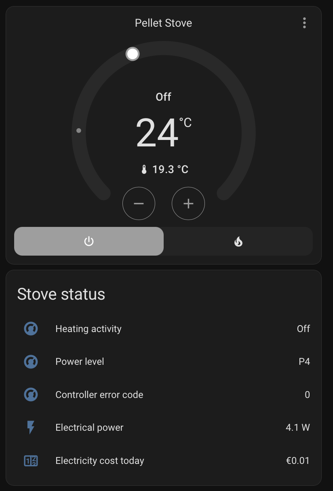
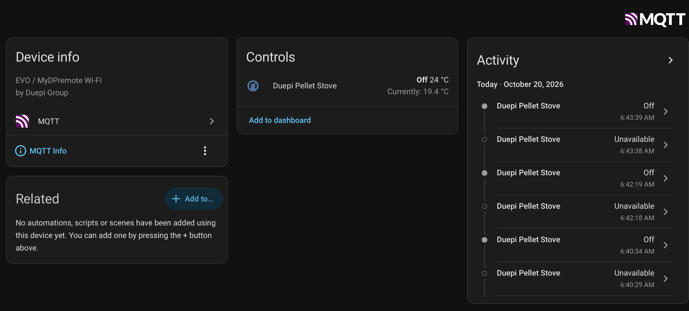

# Duepi local stove controller

Experimental local control for Duepi/MyDPremote pellet stoves using the existing
Wi-Fi module. This repository contains the Home Assistant MQTT app and an
alternative standalone Node.js TCP/HTTP controller. Current source: **1.0.3**.

## Status

Live temperature readings and Heat/Off have worked on one installation.
Intermittent timeouts and reverting power selections remain under investigation.
Version 1.0.3 coordinates polling and commands, separates requested power from
readback, and permits one guarded startup power resend. Those changes have
offline regression coverage and still need physical-stove validation.
See [known issues](KNOWN_ISSUES.md) before use. This is an experimental community
project, unaffiliated with Duepi or Home Assistant.

## Screenshots

Home Assistant thermostat and an example dashboard. Electrical power and cost
are supplied by the user's separate dashboard setup, not this bridge.



MQTT device page with temperature telemetry and recent activity. The history
also shows the intermittent availability issue described above.



## Home Assistant installation

Follow the [installation and configuration guide](duepi_stove_addon/DOCS.md).
Copy only `duepi_stove_addon/` into the Home Assistant local apps/add-ons share,
install the app, then privately configure your device code, stove IP, and MQTT
connection. [UniFi DNS guidance](UNIFI.md) explains network redirection.
This is an MQTT app/add-on, not a HACS integration.

The stove opens an outbound TCP connection; local DNS redirects that connection
to this bridge. The bridge communicates with Home Assistant through your MQTT
broker. No vendor account is required by this implementation.

## Standalone controller

Use Node.js 18 or newer. Supply `DUEPI_CODE` privately through the environment,
then run:

```sh
DUEPI_STOVE_IP=192.0.2.10 node dpremote/stove.js serve 3000 8080
```

Replace the documentation-only example IP with your stove's LAN address. Open
`http://127.0.0.1:8080`. Choose either this controller or the Home Assistant app;
they cannot both own the stove connection. The standalone controller does not
implement the Python bridge's startup power recovery.

## Source and tests

- `duepi_stove_addon/`: Python TCP/MQTT bridge and Home Assistant app packaging.
- `dpremote/stove.js`: standalone Node.js controller and protocol codec.
- `tests/`: simulated TCP peers and synthetic protocol vectors.
- [SPEC.md](SPEC.md): interoperability notes and command register interpretation.

```sh
node --test tests/*.test.js
python3 -m venv .venv
.venv/bin/pip install -r requirements-dev.txt
.venv/bin/python -m unittest discover -s tests -p 'test_*.py' -v
```

The export passes 17 Node tests and 29 Python tests; Python tests have also been
run with Paho MQTT 1.6.1 and 2.1.0. These do not replace Home Assistant packaging
checks or live appliance testing.

## Credits and license

Thanks to **[Florian Casse](https://github.com/FlorianCasse)**, author of
**[DuepiRemoteHA](https://github.com/FlorianCasse/DuepiRemoteHA)**, for the MIT-licensed
cloud integration that informed our requested-power/startup-recovery approach.
Our local TCP/MQTT implementation uses its own session, cancellation, and
verification rules. Florian's complete MIT notice is preserved in
[THIRD_PARTY_NOTICES.md](THIRD_PARTY_NOTICES.md) and in the add-on folder.

This project's code is available under the [MIT license](LICENSE).
Use the source tree for 1.0.3; GitHub's **Code → Download ZIP** provides a source archive.

## Privacy and contributions

This is a separate public export: it includes no private research history,
vendor binaries, captures, logs, device credentials, or installation-specific
network identifiers. The shared key-derivation mask is a protocol constant;
your device code and derived AES key remain private. Test vectors use synthetic
credentials. Never post unsanitized logs, captures, or Home Assistant options.

Use [CONTRIBUTING.md](CONTRIBUTING.md) for changes and [SECURITY.md](SECURITY.md)
for sensitive reports.
