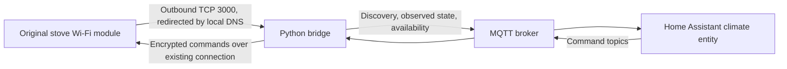
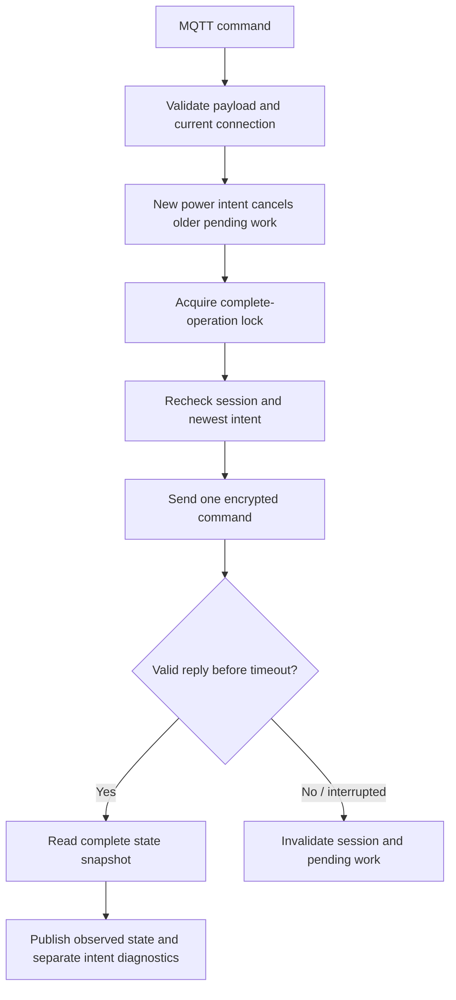

# Architecture and command flows

Current app: **1.0.3**. Read [known issues](../KNOWN_ISSUES.md) for validation
limits and [maintenance](MAINTENANCE.md) before changing or publishing code.

## Connection and discovery

The module opens the TCP connection; the bridge does not connect to a listening
port on the stove. The configured peer IP is allowlisted, one connection is
accepted, and app clients are rejected. This is not cryptographic peer identity.
MQTT discovery registers one climate entity; fixed client ID/topics/device ID
mean one stove per broker. Availability represents a connected socket, not
guaranteed fresh readings. Retained state can be stale while unavailable.

`run.sh` reads app options and obtains MQTT service settings from Supervisor
when available. `stove_bridge.py` derives the AES key locally from the private
device code and shared mask. [SPEC.md](../SPEC.md) documents frame/checksum rules.
No vendor binary, account, or cloud passthrough is part of this bridge.

## Commands and polling

An operation lock prevents whole polls and command verification from interleaving.
The wire-command lock gives each exchange exclusive reply ownership. Concurrent
refreshes coalesce after a completed poll; newer queued power requests supersede
older ones before writing. Offline commands are discarded. A poll reads status,
ambient temperature, setpoint, power setting, and error in that order.

Replies must pass framing, checksum, and payload validation. TCP fragments are
buffered; coalesced/unsolicited frames cannot satisfy a future request. Because
there are no request IDs, an uncertain exchange closes the connection. Never
continue a timed-out session or replay an uncertain write after reconnect.
The default exchange timeout remains four seconds.

## Startup power recovery

The requested setting and reported setting are separate. ACK means a valid
command reply, not proof of physical application. Climate state uses readback;
attributes expose `requested_power`, `power_command_status`, and
`power_request_pending`. A power setting is not measured fan speed.

An acknowledged request can remain pending through startup phases `01`/`02`.
At an observed transition to running `04`, a mismatched valid setting permits
**one** same-session resend, then later polling verifies it. A matching startup
readback can remain pending until normal running because startup may reset it.
An explicit Heat command may first wait for ignition; repeated Heat preserves
the active requested level rather than older reported power.

Off, newer power intent, alarm, disconnect, expiry after 15 minutes, or leaving
the heating cycle cancels deferred work. A fan selection while already off
does not arrange a future startup resend. New connections and process restarts
do not restore pending commands. These rules are regression-tested; physical
startup recovery still needs validation on the target stove.

## Alternative controller and extension points

`dpremote/stove.js` implements the codec, optional private-capture decoder, and
a standalone TCP controller with localhost HTTP UI. Choose it or the Python
bridge; they cannot both own the stove connection. It shares protocol/transport
safeguards but does not implement Python's startup recovery.

Keep protocol changes consistent between languages where applicable. Extend
`tests/stove.test.js` and `tests/test_stove_bridge.py` with observable regressions.
Do not loosen unknown-frame handling, change registers, or increase timeouts
without evidence. Preserve 16–35°C limits until model-specific validation supports
a change. Cloud integration ideas need adaptation to this session-based protocol.

## Attribution

Florian Casse's [DuepiRemoteHA](https://github.com/FlorianCasse/DuepiRemoteHA)
informed requested-power/startup recovery. The implementation here is independent
and adds local session/cancellation/verification rules. Preserve the complete
MIT notice in [THIRD_PARTY_NOTICES.md](../THIRD_PARTY_NOTICES.md).
