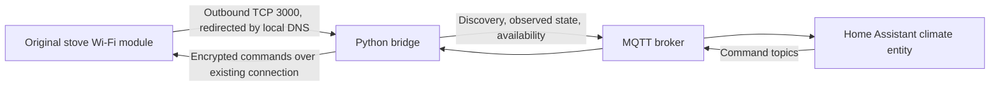
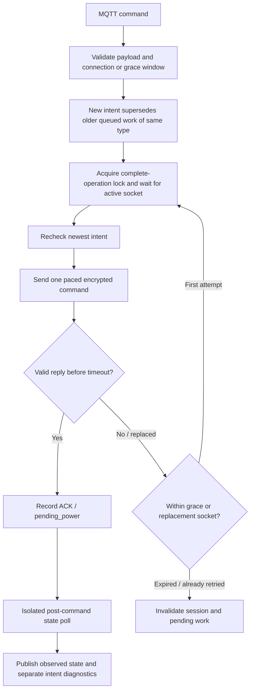

# Architecture and command flows

Current app: **1.0.5**. Read [known issues](../KNOWN_ISSUES.md) for validation
limits and [maintenance](MAINTENANCE.md) before changing or publishing code.

## Connection and discovery

The module opens the TCP connection; the bridge does not connect to a listening
port on the stove. The configured peer IP is allowlisted, a new connection from
that IP immediately replaces any stale previous socket (`TCP_NODELAY` and
`SO_KEEPALIVE`), and app clients are rejected. This is not cryptographic peer
identity. MQTT discovery registers one climate entity; fixed client ID/topics/device
ID mean one stove per broker. Availability stays `online` across brief TCP
reconnects within a 20-second grace window (`availability_grace: 20.0`) before
expiring to `offline`, and represents reachability within that window rather
than guaranteed fresh readings. Retained state can be stale while unavailable.

`run.sh` reads app options and obtains MQTT service settings from Supervisor
when available. `stove_bridge.py` derives the AES key locally from the private
device code and shared mask. [SPEC.md](../SPEC.md) documents frame/checksum rules.
No vendor binary, account, or cloud passthrough is part of this bridge.

## Commands and polling

An operation lock prevents whole polls and command verification from interleaving.
The wire-command lock gives each exchange exclusive reply ownership and enforces
a `150ms` inter-command delay (`command_delay: 0.15`). Concurrent refreshes
coalesce after a completed poll; newer queued power or temperature requests
supersede older ones before writing. Commands arriving when the stove is
genuinely offline (outside the 20s grace window) are discarded, whereas commands
arriving during a poll timeout or brief TCP reconnect wait for the replacement
connection and perform at most one retry if the first write fails before an
application reply arrives. Once a command receives a valid reply, its follow-up
verification poll runs in an isolated error boundary so a readback poll timeout
never erases an acknowledged command. A poll reads status, ambient temperature,
setpoint, power setting, and error in that order, and reconnects wake the poll
loop immediately.

Replies must pass framing, checksum, and payload validation. TCP fragments are
buffered; coalesced/unsolicited frames cannot satisfy a future request, and
10-byte idle heartbeat frames (`\x1b00000000&`) received with no command pending
are ignored quietly. Because there are no request IDs, an uncertain exchange
closes that socket immediately so a late reply on the old socket cannot satisfy
a subsequent command. The default exchange timeout remains four seconds.

## Startup and persistent-mismatch power recovery

The requested setting and reported setting are separate. ACK means a valid
command reply, not proof of physical application. Climate state uses readback;
attributes expose `requested_power`, `power_command_status`, and
`power_request_pending`. A power setting is not measured fan speed.

An acknowledged request can remain pending across brief TCP reconnects within
the 20-second grace window and through startup phases `01`/`02`. If a valid
readback mismatches either at an observed transition from `01`/`02` to running
`04`, or across two consecutive polls (`mismatch_polls >= 2`) in phase `02` or
`04`, the bridge permits **one** guarded resend, then later polling verifies it.
A matching startup readback can remain pending until normal running because
startup may reset it. An explicit Heat command may first wait for ignition;
repeated Heat preserves the active requested level rather than older reported
power.

Off, newer power intent, alarm, grace-window expiry (`_expire_availability`),
expiry after 15 minutes, or leaving the heating cycle cancels deferred work. A
fan selection while already off does not arrange a future startup resend.
Process restarts do not restore pending commands. These rules are
regression-tested; physical recovery still needs validation on the target stove.

## Alternative controller and extension points

`dpremote/stove.js` implements the codec, optional private-capture decoder, and
a standalone TCP controller with localhost HTTP UI. Choose it or the Python
bridge; they cannot both own the stove connection. It shares protocol/transport
safeguards (including stale-session replacement and quiet 10-byte idle frame
handling) but does not implement Python's MQTT availability grace or
startup/mismatch recovery.

Keep protocol changes consistent between languages where applicable. Extend
`tests/stove.test.js` and `tests/test_stove_bridge.py` with observable regressions.
Do not loosen unknown-frame handling, change registers, or increase timeouts
without evidence. Preserve 16–35°C limits until model-specific validation supports
a change. Cloud integration ideas need adaptation to this session-based protocol.

## Attribution

Florian Casse's [DuepiRemoteHA](https://github.com/FlorianCasse/DuepiRemoteHA)
informed requested-power/startup recovery. The implementation here is independent
and adds local session/cancellation/verification rules. Preserve the complete
MIT notice in [THIRD_PARTY_NOTICES.md](../THIRD_PARTY_NOTICES.md).
